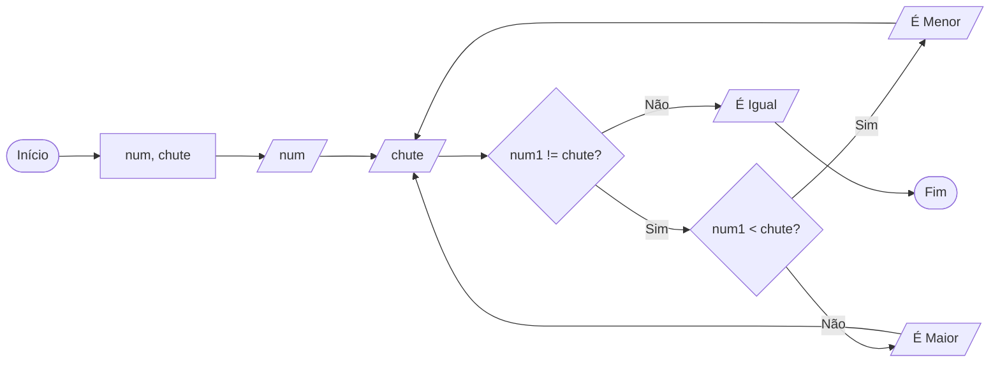

# Q2 Flowchart

Crie um metodo que receba um numero inteiro, utilize um laço faça enquanto e pergunte para o usuario chutar um segundo numero, se o segundo chutado for menor que o parametro informado mostre a mensagem E MENOR e repita o laço,  se o segundo chutado for maior que o parametro informado mostre a mensagem E MAIOR e repita o laço, se for igual mostre a mensagem E IGUAL e interrompa o laço.

## Jogo adivinhe o número

