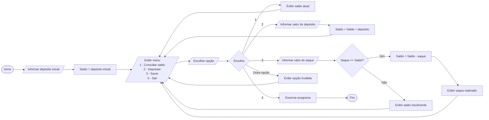

# Q3 Flowchart

Implemente o laço faça enquanto com a pergunta deseja continua S/N para implementar a repetição do algorimo de caixa eletronico, usando na atividade de SWITCH CASE

## Switch case: caixa eletrônico
